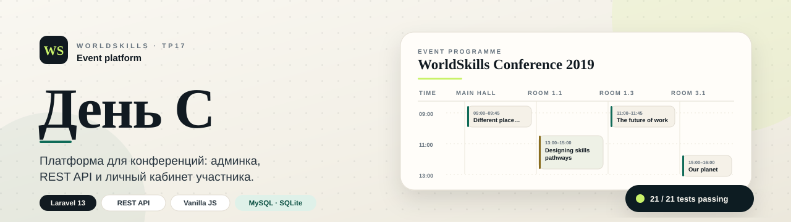
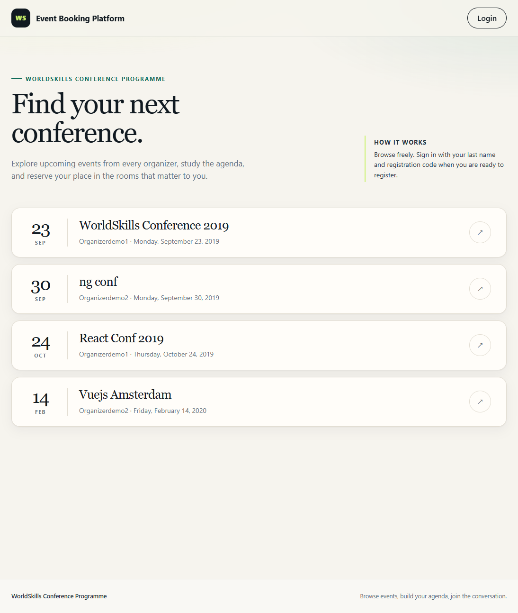
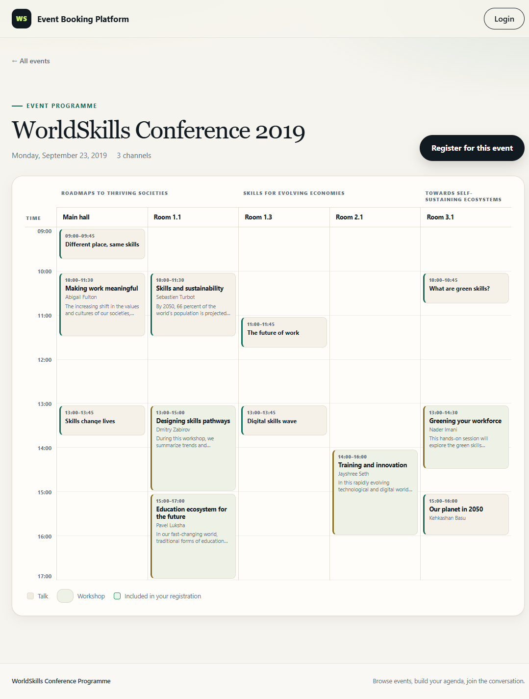
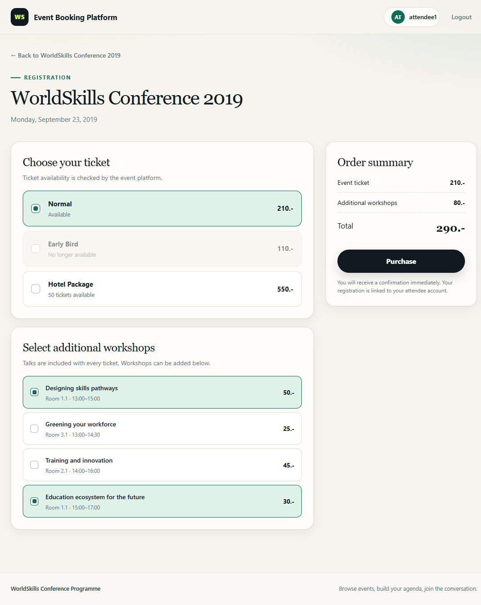
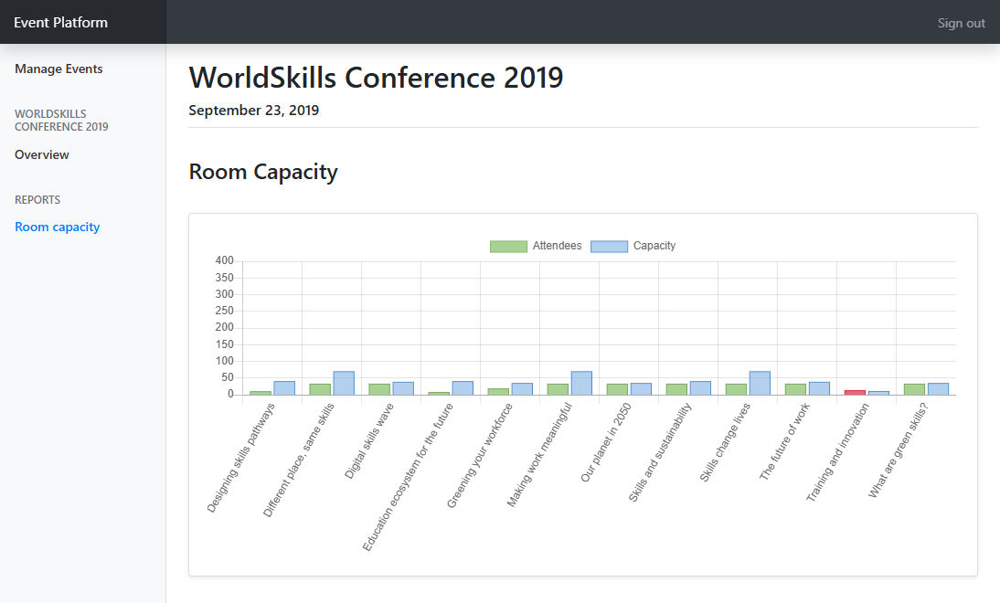
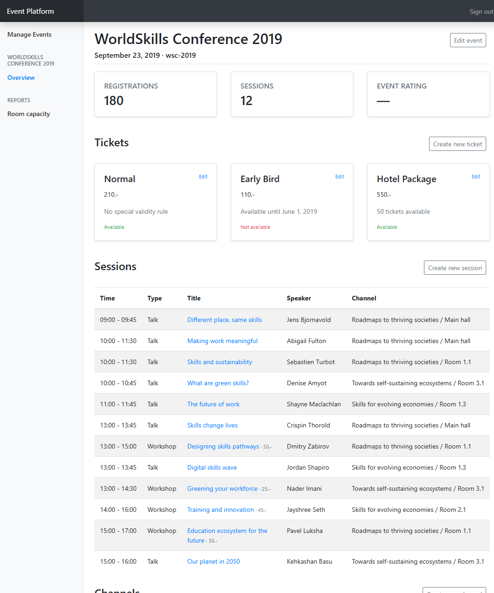
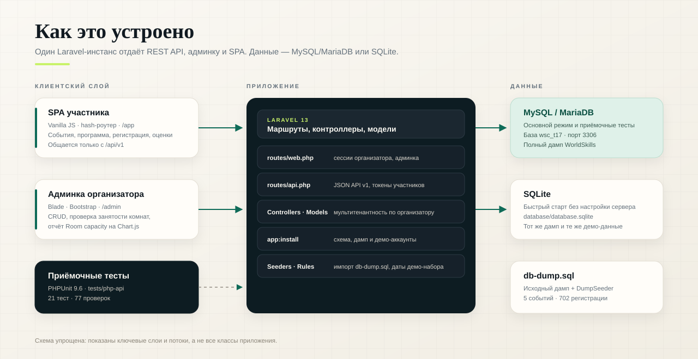

<p align="center">
  
</p>

<h1 align="center">День С</h1>

<p align="center">
  Платформа для проведения конференций: админка организатора, REST API и личный кабинет участника.
</p>

<p align="center">
  
  
  
  
  
</p>

<p align="center">
  <a href="#скриншоты">Скриншоты</a> ·
  <a href="#быстрый-старт">Быстрый старт</a> ·
  <a href="#демо-доступы">Демо-доступы</a> ·
  <a href="#приёмочные-тесты">Тесты</a> ·
  <a href="#rest-api">API</a>
</p>

---

## Что это

Учебный проект по компетенции **WorldSkills TP17 «Веб-разработка» (День С2)**.
Один Laravel-инстанс обслуживает три сценария:

- **Организатор** управляет событиями, билетами, сессиями, каналами и комнатами в админке.
- **Участник** просматривает программу, выбирает билет и воркшопы, регистрируется и ставит оценки.
- **Внешний клиент** работает с теми же данными через JSON API `/api/v1`.

В основе — реальный дамп WorldSkills: 5 событий, 702 регистрации и 200 участников.
Даты датасета (2019 год) сохранены, поэтому «ближайшие события» и правила билетов
считаются от `2019-09-23` — это настраивается в `.env`.

## Возможности

### Админка организатора

- Вход по email и паролю, сессионная авторизация.
- CRUD событий, билетов, сессий, каналов и комнат.
- Проверка пересечения сессий в одной комнате: `Room already booked during this time`.
- Валидация слагов (`a-z`, `0-9`, `-`) и уникальности в рамках организатора.
- Мультитенантность: организатор видит только свои события (чужое событие → 404).
- Отчёт **Room capacity** с диаграммой Chart.js: участники против вместимости комнат.

### Личный кабинет участника (`/app`)

- Просмотр списка событий без авторизации.
- Программа в виде дневной сетки: каналы, комнаты, время, спикеры.
- Вход по фамилии и шестизначному коду регистрации.
- Выбор билета и дополнительных воркшопов с пересчётом итоговой стоимости.
- Список своих регистраций, отметки «уже зарегистрирован».
- Оценка события и отдельных сессий (1–5 звёзд).

### REST API

- Токены участников, JSON-ответы, коды `200 / 401 / 404 / 422`.
- Регистрация на событие, список регистраций, рейтинги.
- Полная совместимость с оригинальным набором приёмочных тестов WorldSkills.

## Скриншоты

| Список событий | Программа конференции |
| --- | --- |
|  |  |

| Выбор билета и воркшопов | Отчёт по вместимости |
| --- | --- |
|  |  |

<p align="center">
  
</p>

## Быстрый старт

Нужны только **PHP 8.3+** и **Composer**. База данных по умолчанию — SQLite,
поэтому отдельно ставить MySQL не нужно.

```bash
git clone https://github.com/MarFaus/day-C.git
cd day-C
composer install
composer setup
php artisan serve
```

Откройте <http://127.0.0.1:8000>.

`composer setup` делает всё сам:

1. создаёт `.env` из `.env.example`, если его ещё нет;
2. генерирует `APP_KEY`;
3. создаёт `database/database.sqlite` и рабочие каталоги;
4. накатывает схему, импортирует дамп и задаёт пароли демо-аккаунтам.

> **Windows:** команды выполняются в PowerShell. Если `php` или `composer`
> не найдены, добавьте их в `PATH` (например, из Laragon, XAMPP или php.new).

### Вариант на MySQL / MariaDB

MySQL нужен для запуска оригинального набора приёмочных тестов. Порядок:

```powershell
mysql -u root -e "CREATE DATABASE wsc_t17 CHARACTER SET utf8mb4 COLLATE utf8mb4_unicode_ci;"
Copy-Item .env.mysql.example .env -Force
php artisan key:generate
php artisan app:install --fresh
php artisan serve
```

В `.env` проверьте `DB_HOST`, `DB_PORT`, `DB_USERNAME` и `DB_PASSWORD`.
Для macOS/Linux вместо `Copy-Item` используйте `cp .env.mysql.example .env`.

## Демо-доступы

| Роль | Логин | Пароль / код |
| --- | --- | --- |
| Организатор `demo1` | `demo1@worldskills.org` | `demopass1` |
| Организатор `demo2` | `demo2@worldskills.org` | `demopass2` |
| Участник | `Yakovich` | `35DGZX` |
| Участник | `Darthe` | `UP243M` |

- Админка: <http://127.0.0.1:8000/login>
- Приложение участника: <http://127.0.0.1:8000/app>

`demo2` нужен, чтобы проверить изоляцию: он не видит события `demo1`.

## Приёмочные тесты

Тесты лежат в `tests/php-api` и работают как чёрный ящик: поднимают данные
в MySQL, ходят по HTTP к запущенному приложению и проверяют ответы API.

1. Запустите приложение на MySQL (см. выше).
2. Настройте окружение тестов:

```powershell
cd tests/php-api
composer install
Copy-Item .env.example .env -Force
```

3. Убедитесь, что в `tests/php-api/.env` правильные значения:

```dotenv
DB_HOST=127.0.0.1
DB_USER=root
DB_PW=
DB_NAME=wsc_t17
URL=http://127.0.0.1:8000
```

`URL` указывается **без** завершающего слэша. Порт MySQL зашит в тестовый
клиент — база должна слушать `3306`.

4. Запустите:

```bash
composer test
```

Ожидаемый результат:

```text
.....................                                             21 / 21 (100%)

OK (21 tests, 77 assertions)
```

Тесты сбрасывают данные в `wsc_t17` перед прогоном. Для запуска одного блока:

```bash
composer test -- --filter B2EventDetailTest
```

> В комплекте PHPUnit обновлён до 9.6, а кастомный принтер
> `tests/printer.php` адаптирован под новый API. Поэтому сводка B1–B4
> остаётся читаемой.

## REST API

Базовый префикс — `/api/v1`. Аутентификация участника — заголовок
`Authorization: Bearer <token>` или параметр `?token=`.

| Метод | Путь | Назначение |
| --- | --- | --- |
| `GET` | `/events` | Ближайшие события |
| `GET` | `/organizers/{organizer}/events/{event}` | Детали события и программа |
| `POST` | `/login` | Вход участника (`lastname`, `registration_code`) |
| `POST` | `/logout` | Выход |
| `POST` | `/organizers/{organizer}/events/{event}/registration` | Регистрация |
| `GET` | `/registrations` | Регистрации текущего участника |
| `GET` | `/ratings` | Оценки текущего участника |
| `POST` | `/events/{event}/rating` | Оценка события |
| `POST` | `/sessions/{session}/rating` | Оценка сессии |

Пример:

```bash
curl -X POST http://127.0.0.1:8000/api/v1/login \
  -H "Content-Type: application/json" \
  -d '{"lastname":"Yakovich","registration_code":"35DGZX"}'
```

## Как устроен проект

<p align="center">
  
</p>

```text
app/Http/Controllers/Admin   CRUD админки и отчёт по комнатам
app/Http/Controllers/Api     REST API для участников
app/Models                   Eloquent-модели и правила билетов
app/Console/Commands         app:install — установка и демо-данные
database/migrations          схема БД
database/seeders             импорт database/db-dump.sql
public/assets/attendee       SPA участника (HTML/CSS/JS без сборки)
resources/views              Blade-шаблоны админки и входа
routes/web.php               админка и страницы
routes/api.php               JSON API /api/v1
tests/php-api                приёмочные тесты PHPUnit
docs/                        баннер, схема и скриншоты
```

### Технологии

- **Backend:** PHP 8.3, Laravel 13, Eloquent, сессии, middleware.
- **База:** SQLite для быстрого старта, MySQL/MariaDB для тестов и «боевого» режима.
- **Frontend:** Blade + Bootstrap в админке, vanilla JS SPA у участника, Chart.js.
- **Тесты:** PHPUnit 9.6, HTTP-клиент на cURL, собственный printer для отчёта B1–B4.

## Особенности датасета

- `EVENTS_UPCOMING_FROM=2019-09-23` — от какой даты считать «ближайшие» события.
- `RULES_AS_OF=2019-09-23` — опорная дата для правил доступности билетов.
- В демо-базе: 5 событий, 702 регистрации, 200 участников.
- `database/db-dump.sql` — исходный дамп; `DumpSeeder` импортирует его и
  проставляет пароли организаторам, чтобы демо-вход работал сразу.

## Ограничения

Проект учебный и не рассчитан на продакшен: демо-пароли лежат в репозитории,
`APP_DEBUG=true`, нет rate limiting и полноценной политики паролей.
Для реального запуска включите HTTPS, смените доступы и настройте очередь/кэш.

---

<p align="center">
  <sub>WorldSkills TP17 · День С2 · Laravel + REST API + SPA</sub>
</p>
